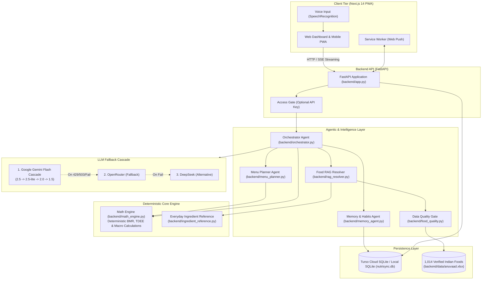

# NutriSync

[](https://github.com/lohith400/Nutrition_traker/actions/workflows/ci.yml)
[](#testing--quality-assurance)
[](#testing--quality-assurance)
[](LICENSE)
[](https://www.python.org/)
[](https://fastapi.tiangolo.com/)
[](https://nextjs.org/)

> **An agentic AI nutrition coach and macro tracker crafted specifically for authentic Indian food, combining verified dietary datasets with a deterministic math engine.**

🔗 **Live Web App:** [https://nutrition-traker.vercel.app](https://nutrition-traker.vercel.app) &nbsp;|&nbsp; 📖 **Architecture:** [How It Works](docs/HOW_IT_WORKS.md)

<!-- DEMO: uncomment after adding docs/demo/demo.gif
<p align="center"></p>
-->

---

## Overview

Most generic calorie trackers fail on Indian cuisine—they misjudge composite gravies, lack regional preparations, and hallucinate portion weights.

**NutriSync** solves this with a purpose-built dual architecture:
1. **Agentic AI & Food RAG:** Coordinates food matching, meal planning, and contextual coaching using a multi-provider LLM fallback (Google Gemini, OpenRouter, DeepSeek).
2. **Deterministic Math Engine:** Pure, testable Python functions compute basal metabolic rate (BMR), total daily energy expenditure (TDEE), macronutrient distributions, and ICMR Recommended Dietary Allowances (RDA). **The language model never performs raw calorie arithmetic.**
3. **Curated Indian Food Database:** 1,014 verified Indian foods sourced from the **Indian Food Composition Tables (IFCT / ICMR-NIN)** and the **Anuvaad** project, enforced with an automated data-quality gate.

---

## Screenshots

<!-- SCREENSHOTS: uncomment after adding dashboard.png, food-log.png, chat-coach.png, and progress.png to docs/screenshots/
| Daily Dashboard & Macro Thali | Smart Food & Recipe Logging |
| :---: | :---: |
|  |  |

| AI Coach Chat (Streaming + Voice) | Progress & Consistency Heatmap |
| :---: | :---: |
|  |  |
-->

*(Screenshots can be added to `docs/screenshots/`)*

---

## Features

- 🍛 **Authentic Indian Food Logging:** Search 1,014 verified Indian recipes and staples. Log by standard weights (grams) or traditional Indian household measures (katoris, rotis, tablespoons, cups, pieces).
- ✨ **Spatial 3D & Pantry Almanac Experience:** Crafted product-film aesthetics featuring warm tungsten lighting, brushed steel, terracotta, and procedural Three.js/React Three Fiber components (`TodayPlate3D`, `HydrationJar3D`, `VitaminShelf3D`, and interactive `CoachOrb`).
- 📖 **The Story Almanac (`/story`):** Cinematic 5-act narrative journey demonstrating the 1,014 IFCT food composition dataset, nutrient gaps, and real-time ledger mechanics.
- 🤖 **Agentic AI Coach with Streaming Responses:** Real-time conversational coach answering dietary questions, reviewing daily meals, and providing personalized recommendations via Server-Sent Events (SSE) paired with an active Fibonacci point-cloud `CoachOrb`.
- 🎙️ **Voice Chat:** Hands-free English voice input using browser Speech Recognition for effortless food logging and chat.
- 🥗 **Indian Meal Planning:** Intelligent meal plans tailored to target caloric ranges, regional preferences, and dietary restrictions (vegetarian, vegan, high-protein).
- 🛒 **Smart Grocery Generator:** Automatically aggregates raw ingredients and staple quantities needed for planned meals.
- 🔔 **Native Web Push Notifications:** Lock-screen PWA notifications via VAPID Web Push (plus optional SMTP email reminders) for water, logging, and meal check-ins.
- 💧 **Apothecary Hydration Tracking:** Visual water carboy tracker with quick-logging increments (+250 ml glass, +500 ml mug, +1.0 L bottle) with fluid 3D glass and wave simulation.
- ⚖️ **Weight & Trend Analytics:** Historical weight tracking, deficit/surplus pacing, and projected goal target dates.
- 📅 **Consistency Heatmap:** 5-week GitHub-style activity matrix tracking daily logging streaks and nutritional adherence with botanical sage and forest tokens.
- 🍳 **Custom Foods & Recipe Builder:** Break down home-cooked meals by ingredient. Combines raw staples (`backend/ingredient_reference.py`) with deterministic mathematical summing.
- 🛡️ **Data Quality Gate:** Flags unrealistic serving densities or Atwater formula discrepancies before suggestions are surfaced to the user.
- ⚡ **Adaptive Quality Tiers:** Dynamically adapts GPU rendering across `high`, `mid`, `low`, and `none` tiers with zero-cost 2D fallbacks, preserving strict sub-125 kB first-load performance.

---

## System Architecture



---

## Tech Stack

| Layer | Technologies |
| :--- | :--- |
| **Frontend** | [Next.js 14](https://nextjs.org/) (App Router), [React 18](https://react.dev/), [TypeScript](https://www.typescriptlang.org/), Vanilla CSS Design System, [Lucide React](https://lucide.dev/) |
| **3D & Visuals** | [Three.js](https://threejs.org/), [@react-three/fiber](https://docs.pmnd.rs/react-three-fiber), [GSAP](https://gsap.com/), [Lenis](https://lenis.darkroom.engineering/) |
| **Backend API** | [Python 3.11+](https://www.python.org/), [FastAPI](https://fastapi.tiangolo.com/), [Uvicorn](https://www.uvicorn.org/), [Pydantic v2](https://docs.pydantic.dev/) |
| **Nutrition Engine** | Deterministic Python Math Engine (Mifflin-St Jeor, ICMR-NIN 2020 RDA, Atwater Factors) |
| **AI / LLM** | Google Gemini (`google-genai`), OpenRouter API, DeepSeek Chat (`openai` SDK compatible) |
| **Database** | [Turso](https://turso.tech/) (Cloud `libsql`) or Local [SQLite3](https://www.sqlite.org/) |
| **Notifications** | Native PWA Web Push ([pywebpush](https://github.com/web-push-libs/pywebpush), VAPID), SMTP Email |
| **Deployment** | [Vercel](https://vercel.com/) (Frontend), Azure VM + Docker + [Caddy](https://caddyserver.com/) (Backend) |
| **CI / CD** | GitHub Actions (Automated Linting, Smoke Testing, Container Builds, Push-to-Deploy) |

---

## Project Structure

```text
.
├── backend/                   # FastAPI backend & core nutrition engine
│   ├── app.py                 # REST API endpoints & SSE streaming handlers
│   ├── math_engine.py         # Pure deterministic nutrition and calorie math
│   ├── rag_resolver.py        # Food-name matching, normalization & ingredient lookup
│   ├── orchestrator.py        # AI coach service with tool-calling
│   ├── menu_planner.py        # Indian meal recommendation engine
│   ├── memory_agent.py        # User profile, history, and streak persistence
│   ├── food_quality.py        # Anuvaad dataset quality gate & Atwater validation
│   ├── ingredient_reference.py# Built-in reference values for everyday staples
│   ├── db_setup.py            # Database schema setup & dataset loader
│   ├── llm_config.py          # Multi-provider LLM fallback
│   ├── reminders.py           # Native Web Push and email reminder dispatch
│   ├── data/                  # Source nutritional data (anuvaad.xlsx)
│   ├── requirements.txt       # Production Python dependencies
│   └── .env.example           # Backend environment template
├── frontend/                  # Next.js 14 App Router frontend
│   ├── app/                   # App Router pages, components & layouts
│   │   ├── story/             # 3D interactive thali scroll story
│   │   ├── components/        # UI components (TodayPlate, HydrationJar, VitaminShelf)
│   │   ├── log/               # Food logging page
│   │   ├── chat/              # AI Coach streaming chat interface
│   │   ├── meal-plans/        # Meal planning dashboard
│   │   ├── grocery/           # Grocery checklist
│   │   ├── reminders/         # Notification preferences & subscription manager
│   │   ├── custom-foods/      # Recipe builder
│   │   └── progress/          # Weight & consistency charts
│   ├── public/                # Static assets, PWA manifest, and service worker (sw.js)
│   └── package.json           # Frontend dependencies
├── docker/                    # Docker initialization scripts
├── docs/                      # Technical documentation & guides
│   ├── DATA_SOURCES.md        # Dataset provenance, citations & quality metrics
│   ├── DEMO_SCRIPT.md         # 60-second walkthrough demo recording script
│   ├── DEPLOYMENT.md          # Production operations & container deployment
│   ├── FREE_DEPLOYMENT.md     # Free-tier cloud setup (Render + Turso + Vercel)
│   ├── HOW_IT_WORKS.md        # System architecture, sequence diagrams & design choices
│   ├── demo/                  # Video demo and animated GIF slot (.gitkeep)
│   └── screenshots/           # Application screenshots
├── scripts/                   # Utility scripts (e.g. generate_vapid_keys.py)
├── tests/                     # Automated unit and smoke test suites
│   ├── unit/                  # Deterministic unit tests (math engine, food matching, quality)
│   └── test_smoke.py          # End-to-end FastAPI integration smoke tests
├── .env.example               # Root environment configuration template
├── CONTRIBUTING.md            # Contribution guidelines
├── CODE_OF_CONDUCT.md         # Community code of conduct
├── SECURITY.md                # Security vulnerability reporting policy
├── LICENSE                    # MIT License
└── Makefile                   # Common developer workflow commands
```

---

## Getting Started

### Prerequisites
- **Python**: Version 3.11 or 3.12
- **Node.js**: Version 18.x or 20.x (`npm`)
- **Docker & Docker Compose** *(optional, for containerized run)*

---

### Option A: Running with Docker Compose (Fastest)

1. **Clone the repository:**
   ```bash
   git clone https://github.com/lohith400/Nutrition_traker.git
   cd Nutrition_traker
   ```

2. **Configure environment:**
   ```bash
   cp .env.example .env
   # Add your GEMINI_API_KEY or OPENROUTER_API_KEY in .env for AI coach features
   ```

3. **Start services:**
   ```bash
   docker compose up -d --build
   ```
   - **Frontend:** [http://localhost:3000](http://localhost:3000)
   - **Backend Health:** [http://localhost:8000/health](http://localhost:8000/health)

---

### Option B: Local Manual Setup (Two Terminals)

#### 1. Backend Setup (Port 8000)
Open a terminal in the repository root:

```bash
# Create and activate virtual environment
python -m venv venv
source venv/bin/activate       # On Windows PowerShell: .\venv\Scripts\Activate.ps1

# Install dependencies
pip install --upgrade pip
pip install -r backend/requirements.txt -r requirements-dev.txt

# Initialize database from anuvaad.xlsx (creates nutrisync.db)
python backend/db_setup.py

# Start FastAPI server
python -m uvicorn backend.app:app --reload --port 8000
```
Verify at [http://localhost:8000/health](http://localhost:8000/health) or [http://localhost:8000/docs](http://localhost:8000/docs).

#### 2. Frontend Setup (Port 3000)
Open a second terminal:

```bash
cd frontend

# Install dependencies
npm install

# Start Next.js development server
npm run dev
```
Open [http://localhost:3000](http://localhost:3000) in your browser.

---

## Environment Variables

NutriSync runs out-of-the-box locally with SQLite without external services. For AI coaching, cloud database, or push notifications, configure the variables below in your `.env` file:

| Variable | Description | Required? | Default / Notes |
| :--- | :--- | :---: | :--- |
| `GEMINI_API_KEY` | Google AI Studio API key | Optional | Primary LLM provider with automatic cascade |
| `OPENROUTER_API_KEY` | OpenRouter API key | Optional | Secondary fallback provider |
| `DEEPSEEK_API_KEY` | DeepSeek API key | Optional | Alternative LLM provider |
| `LLM_PROVIDER` | Force specific provider (`gemini` / `openrouter` / `deepseek`) | Optional | Auto-detected from available keys |
| `TURSO_DATABASE_URL` | Turso Cloud SQLite database URL | Optional | If blank, uses local SQLite (`nutrisync.db`) |
| `TURSO_AUTH_TOKEN` | Turso Cloud authentication token | Optional | Required only when `TURSO_DATABASE_URL` is set |
| `ACCESS_KEY` | Master access key protecting the API | Optional | Blank allows open access for local dev |
| `CORS_ORIGINS` | Allowed CORS origins (comma-separated) | Optional | `http://localhost:3000` |
| `GOOGLE_MAPS_API_KEY` | Google Places API key for restaurant discovery | Optional | Enables "restaurants near me" in chat |
| `VAPID_PUBLIC_KEY` | Application server public key for Web Push | Optional | Generate with `python scripts/generate_vapid_keys.py` |
| `VAPID_PRIVATE_KEY`| Application server private key for Web Push | Optional | Generate with `python scripts/generate_vapid_keys.py` |
| `VAPID_CLAIM_EMAIL`| Contact email included in Web Push VAPID claims | Optional | e.g. `mailto:you@example.com` |
| `SMTP_HOST` | SMTP server host for email notifications | Optional | `smtp.gmail.com` |
| `SMTP_PORT` | SMTP port | Optional | `587` |
| `SMTP_USER` | SMTP username / address | Optional | Required for email reminders |
| `SMTP_PASSWORD` | SMTP password / App Password | Optional | Required for email reminders |
| `TZ` | Server timezone (Linux/Docker) | Optional | `Asia/Kolkata` |
| `NEXT_PUBLIC_API_URL`| Public backend API address reachable from browser | Required | `http://localhost:8000` |

---

## Deployment & Production Architecture

NutriSync is deployed in a cost-effective architecture with automated deploys, health checks, and automatic rollback:

1. **Frontend on Vercel:**
   - Next.js 14 client deployed on Vercel edge infrastructure.
   - Fast worldwide CDN delivery with automatic SSL and PWA caching.
2. **Backend on Cloud VM (Docker + Caddy):**
   - FastAPI server running containerized via Docker on an Azure Virtual Machine.
   - [Caddy](https://caddyserver.com/) operates as the reverse proxy, automatically managing Let's Encrypt TLS certificates, HTTP/2 termination, and gzip/zstd compression.
3. **Database on Turso:**
   - Serverless `libsql` edge database enabling persistent data across ephemeral container deployments without disk lock contention.
4. **Automated CI/CD:**
   - **Continuous Integration (`ci.yml`):** Runs Ruff linting, Pytest smoke test suites, unit tests with coverage reporting, TypeScript type checks, and Next.js builds on every pull request and push to `main`.
   - **Continuous Deployment (`deploy.yml`):** On changes to backend, docker, or test code, GitHub Actions validates tests and safely triggers production deployment over SSH with health verification and automatic rollback.

*(For detailed operations, see [docs/DEPLOYMENT.md](docs/DEPLOYMENT.md) and [docs/FREE_DEPLOYMENT.md](docs/FREE_DEPLOYMENT.md)).*

---

## Testing & Quality Assurance

Run the test suite with coverage reporting locally before pushing changes:

```bash
# Run all tests with coverage
pytest tests/ --cov=backend --cov-report=term-missing --cov-report=xml

# Run only unit tests
pytest tests/unit --cov=backend

# Lint Python codebase with Ruff
ruff check .

# Lint and typecheck frontend
cd frontend
npm run lint
npm run build
```

---

## Roadmap

- [ ] **3D Scroll Story Integration:** Full roll-out of the cinematic 3D thali landing page.
- [ ] **Chat Latency Optimization:** Speculative pre-tokenization and lower TTFT on agentic responses.
- [ ] **Multi-User Isolation:** Optional user authentication profiles and synced multi-device storage.
- [ ] **Health Connect & Wearables Sync:** Direct integration with Google Health Connect for step counts and active calorie burn.

---

## Data Sources & Attribution

NutriSync's Indian food database is compiled from:
- **Indian Food Composition Tables (IFCT)**, published by the **National Institute of Nutrition (ICMR-NIN)**, Hyderabad, India.
- The open-source **Anuvaad** dataset project.

For detailed attribution, dataset metrics, and license notes, see [docs/DATA_SOURCES.md](docs/DATA_SOURCES.md).

---

## License

The code and design of NutriSync are licensed under the **[MIT License](LICENSE)**.  
Copyright (c) 2026 Lohith S.