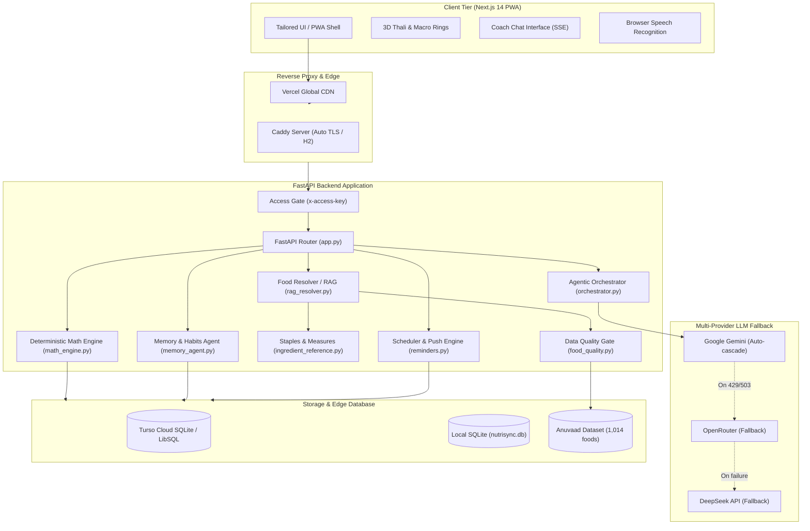
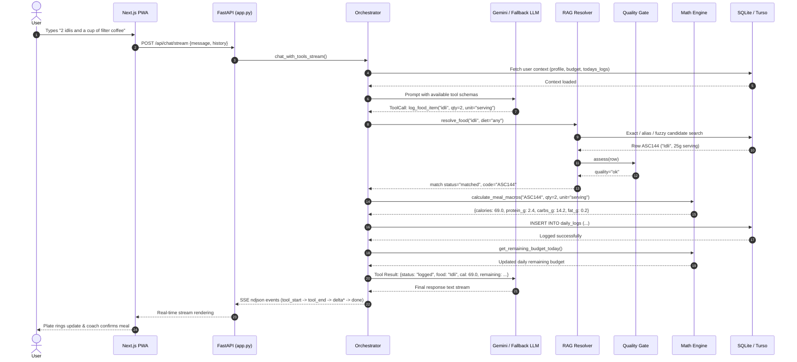
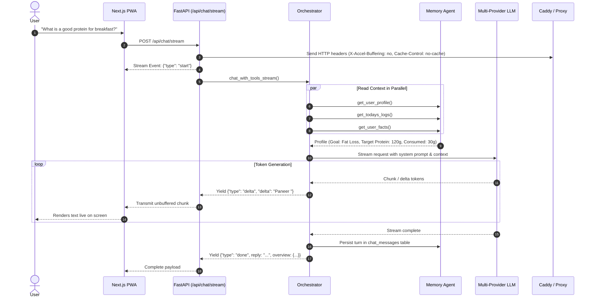

# NutriSync: How It Works & Architecture Guide

NutriSync is an agentic AI nutrition coach and macro tracking Progressive Web App (PWA) built specifically for authentic Indian dietary patterns. This document details its architecture, end-to-end request flows, and engineering design decisions.

---

## 1. Overview

Most generic calorie trackers (MyFitnessPal, HealthifyMe, etc.) fail on Indian food:
- They miscalculate complex composite gravies and mixed-flour breads.
- They lack regional preparations (e.g., *thatte idli*, *ragi mudde*, *puranpoli*).
- They hallucinate serving sizes or confuse raw and cooked weights.
- When AI is bolted on, language models frequently hallucinate arithmetic, producing nonsensical caloric totals.

NutriSync solves this with a **bifurcated architecture**:
1. **Agentic AI & Retrieval:** Coordinates natural language intent, portion resolution, and empathetic coaching using a resilient LLM fallback cascade (Google Gemini, OpenRouter, DeepSeek).
2. **Deterministic Math Engine:** Plain Python functions calculate BMR, TDEE, macronutrient splits, and daily budgets without model involvement. **The language model never performs arithmetic.**
3. **Verified Indian Food Database:** 1,014 verified items from the Indian Food Composition Tables (IFCT / ICMR-NIN) and the Anuvaad project, protected by an automated quality gate (`backend/food_quality.py`).

---

## 2. System Architecture

---

## 3. End-to-End Sequence Diagrams

### (a) Log Food by Typing a Sentence

When a user types a natural sentence (e.g., *"2 idlis and a cup of filter coffee"*):

---

### (b) Ask the Coach a Question with Streaming

When a user asks for dietary advice (e.g., *"What is a good high-protein breakfast for my weight goal?"*):

---

## 4. Key Design Decisions

### 1. Deterministic Math Engine
- **Decision:** All caloric, macro, BMR, TDEE, and daily balance arithmetic is implemented in pure Python (`backend/math_engine.py`), never delegated to an LLM.
- **Why:** Large language models are probabilistic token predictors notoriously unreliable at arithmetic. Allowing an LLM to compute totals leads to hallucinated numbers (e.g., claiming 2 rotis equal 1,200 calories).
- **Trade-off:** Strict input schemas and conversion layers are required before numbers reach the math engine; free-form unstructured mathematical queries require tool invocation.

### 2. Verified Indian Dataset & Automated Quality Gate
- **Decision:** All food lookups query a verified 1,014-item dataset (`backend/data/anuvaad.xlsx`) and staple reference table (`backend/ingredient_reference.py`). Every row is audited by `backend/food_quality.py`.
- **Why:** Raw source datasets often contain recipe totals logged as single servings (e.g., *Paneer pulao* at 4,876 kcal per plate) or impossible macronutrient densities (>50g fat per 100g in cooked dishes). The quality gate flags these as `grams_only` or `unreliable` to protect the user.
- **Trade-off:** Less common regional variations outside the 1,014 dishes must be entered via the custom food recipe builder or reference staple combinations.

### 3. Multi-Provider LLM Fallback Chain
- **Decision:** Implements an automatic cascade across Google Gemini (`gemini-2.5-flash` → `gemini-2.5-flash-lite` → `gemini-2.0-flash` → `gemini-1.5-flash`), with automatic fallbacks to OpenRouter and DeepSeek.
- **Why:** Guarantees zero-crash resilience against free-tier rate limits (HTTP 429), temporary provider outages (HTTP 503), or deprecated model endpoints (HTTP 404).
- **Trade-off:** Multiple API configurations must be maintained; fallback hops across providers introduce a slight latency penalty on the initial retry turn.

### 4. Lightweight Dependencies (Zero-Torch Architecture)
- **Decision:** Food retrieval uses standard Python `difflib`, whole-word token matching, Indian synonym maps (`_GROUPS`), and SQLite substring searches rather than heavyweight vector embeddings or PyTorch.
- **Why:** Keeps the entire backend memory footprint below 250 MB, allowing smooth deployment on free or budget cloud virtual machines (512 MB to 1 GiB RAM).
- **Trade-off:** Does not support deep semantic abstraction (e.g., searching *"something crunchy and spicy with lentils"*); relies on exact, synonym, and typo matching.

### 5. Turso Cloud SQLite (LibSQL)
- **Decision:** Production uses Turso edge database with local SQLite fallback for development.
- **Why:** Modern container hosts (Render, Fly.io) use ephemeral filesystems where container restarts or cold boots wipe local disk. Turso retains SQLite syntax and simplicity while persisting data remotely across restarts.
- **Trade-off:** Every query costs a network round-trip. To maintain responsiveness, `backend/database.py` implements per-thread connection pooling and batch statement execution.

### 6. Unbuffered SSE Streaming
- **Decision:** Streaming responses use `StreamingResponse` emitting newline-delimited JSON (`application/x-ndjson`) with explicit reverse proxy headers (`X-Accel-Buffering: no`, `Cache-Control: no-cache, no-transform`).
- **Why:** Ensures users see the coach answer begin streaming within 500–800 ms instead of waiting 5–10 seconds for completion.
- **Trade-off:** Caddy, Nginx, and cloud proxies must preserve streaming headers without buffering buffers.

### 7. Docker + Caddy on Cloud VM with Automatic Rollback
- **Decision:** Containerized FastAPI backend sits behind [Caddy](https://caddyserver.com/) on a cloud VM, orchestrated by GitHub Actions with health checks and rollback.
- **Why:** Caddy automates Let's Encrypt TLS certificate provisioning and renewal with zero human maintenance. Automated CI health checks prevent broken code from completing deployment.
- **Trade-off:** Docker container restarts cause a brief 5–15 second reconnect window during deployments.

### 8. Single Shared Access Key Architecture
- **Decision:** Authentication uses a single master `ACCESS_KEY` validated via HTTP header (`x-access-key`) or query token, rather than multi-tenant user accounts with passwords and JWT tables.
- **Why:** NutriSync was engineered as an intimate, single-user personal nutrition assistant designed for zero-friction setup on the user's mobile device.
- **Trade-off:** Multi-user isolation is not supported in a single instance; each user requires their own isolated instance or database.

---

## 5. Known Limitations & Roadmap

1. **Chat Latency from Sequential LLM Calls:**
   - *Current State:* When tools are invoked, the orchestrator makes two sequential LLM calls (Turn 1: Tool Selection → Tool Execution → Turn 2: Natural Language Summary).
   - *Roadmap:* Implementing speculative token pre-generation and streaming parallel tool parsing to reduce total turnaround latency.
2. **Single-User Architecture:**
   - *Current State:* The application is designed for one primary user profile (`user_profile` table `id=1`).
   - *Roadmap:* Adding optional multi-user tenant profiles with encrypted partition keys.
3. **Wearable & Fitness Tracking:**
   - *Current State:* Uses the Google Fit REST API, which Google has announced is being deprecated in 2025/2026.
   - *Roadmap:* Transitioning fitness sync to Android Health Connect and Apple HealthKit local exports.
4. **Cold Starts on Free Hosting:**
   - *Current State:* On Render free tiers, the container spins down after 15 minutes of inactivity, causing a 30–50 second cold start on first load.
   - *Mitigation:* A GitHub Actions heartbeat ping (`.github/workflows/keep-alive.yml`) runs periodically to maintain container readiness.
